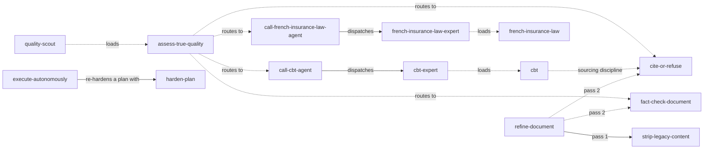

# Skill dependencies

Which skill reaches for which other one. Solid arrow: required. Dotted: recommended, or a pointer the
skill still runs without.

Every skill here installs on its own: none requires a skill outside this catalog.
