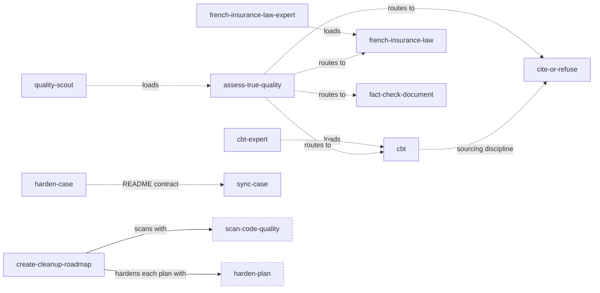

# Skill dependencies

Which skill reaches for which other one. Solid arrow: required. Dotted: recommended, or a pointer that
degrade without it.

The two dotted `create-cleanup-roadmap` edges point into the other catalog:

| Skill here | Needs | Lives in |
| --- | --- | --- |
| `create-cleanup-roadmap` | `scan-code-quality`, `harden-plan` | `Les-Sherpas/agent-skills` |

Both catalogs install side by side (`~/.config/skills/sources` names them), and the store is flat, so
those two edges resolve whenever both are installed — the graph is drawn with them marked as external
because a machine with only this catalog will not have them.

Everything else is self-contained: no skill here requires a skill outside this catalog.
