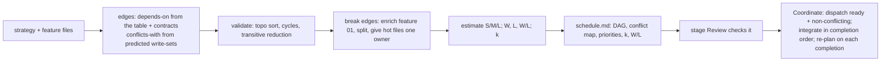

# How should `/campaign` turn its feature list into a dependency graph and schedule so that as many features as possible run in parallel?

Researched 2026-11-28 for a new phase of the `campaign` skill. Today the skill implements features
strictly one at a time, on one linear `gh stack`, inside a single campaign worktree
([`skills/pipelines/campaign/SKILL.md`](../../skills/pipelines/campaign/SKILL.md), §4). Claims
marked *inference* are this report's reasoning, not a source's. Claims marked **verified** say what
was run (see [§10](#10-verification)).

## Answer

**Recommendation.** Add a stage named **Schedule** between Strategy (2) and Review (3), writing
`schedule.md`. Placing it before Review means the reviewers also check the graph and every feature
the phase splits or reshapes ([§9](#9-what-this-changes-in-the-campaign-skill)). Schedule produces
the priorities and constraints. Coordinate (stage 4) dispatches by them as agents free up. The
phase produces no fixed timetable: Graham's anomalies make a fixed plan fragile ([§2](#2-scheduling-algorithms)).

1. **Measure the ceiling first.** Let W be the total estimated work and L the critical path. No
   schedule with k agents beats `max(W/k, L)`, and W/L is the most speedup any number of agents can
   give ([CLRS 3e ch. 27](http://mitp-content-server.mit.edu:18180/books/content/sectbyfn?collid=books_pres_0&fn=0262533057chap27.pdf&id=8030),
   §27.1, work law, span law, "parallelism"). Finding the optimal schedule is NP-hard (Ullman 1975 via
   [Kwok & Ahmad 1999](https://doi.org/10.1145/344588.344618), §2.4), so use a simple greedy rule.
2. **Use critical-path list scheduling, online.** Each feature's priority is its *bottom level*,
   the longest estimated path from it to the end. Break ties by the larger number of direct
   successors (CP/MISF, Kwok & Ahmad §6.2.1). Whenever a slot frees, start the highest-priority
   feature whose parents are integrated. With precedence alone, this is within `2 − 1/k` of optimal
   (Graham 1966 as stated by
   [Svensson, STOC 2010](https://www.csc.kth.se/tcs/projects/publications/PPrecCmax.pdf), §1). It
   holds without knowing durations, because list scheduling "does not use the information about
   running times" ([Sgall 1998](https://iuuk.mff.cuni.cz/~sgall/ps/schsurv.pdf)).
   - **Verified by simulation:** on 2,000 random 15-feature graphs with k = 4, this rule averaged
     1.01× the lower bound, against 1.31× for static waves.
3. **Treat overlapping write-sets as mutual exclusion, not as dependency.** Two features predicted
   to edit the same files or methods may run in either order, but not concurrently
   ([Even et al. 2009](https://doi.org/10.1007/s10951-008-0089-1): "conflicting jobs cannot be
   scheduled concurrently").
   - **Best-supported signal:** shared files. It is not uncontested ([§4](#4-inferring-edges-before-any-code-exists)).
   - **Agents:** concurrent agents on conflicting features fare badly. In CooperBench, two agents
     succeeded 28% of the time working concurrently and 50% when one went first
     ([CooperBench, COLM 2026](https://proceedings.colm.cc/paper_files/paper/2026/hash/12a986b35a1d331e84caec382b58e329-Abstract-Conference.html),
     §4 and App. R; 50-pair subset, one model).
   - **No guarantee:** the 2 − 1/k guarantee does not extend to this filter. No source gives one, so
     it is a heuristic (*inference*).
4. **Break edges by enriching feature 01, not by adding a stub feature.** Put shared interfaces and
   registry entries into the first, thinnest end-to-end feature as real, working code. Later
   features then write disjoint files
   ([Parnas 1972](https://www.cs.colostate.edu/~france/CS314/Readings/Parnas-decomposition.pdf):
   independent development "should begin much earlier"). CAID commits stubs to main before it
   delegates
   ([CAID, COLM 2026](https://proceedings.colm.cc/paper_files/paper/2026/hash/3b5c10bf5d70533e955cba9fba491bf4-Abstract-Conference.html),
   §2.3). A stubs-only feature would break the campaign's rule that every feature serves a success
   criterion (*inference*).
5. **Keep k small: `k = min(4, max(1, ⌊W/L⌋))`** (*inference*).
   - In CAID, going from 2 to 4 engineers helped and 8 hurt, through "integration overhead and
     conflict resolution cost" (CAID §4). That result is for one benchmark (Commit0-Lite).
   - Removing CAID's dependency graph dropped results below the single-agent baseline (App. C).
6. **Keep the single linear stack.** Implement features in parallel worktrees, then add each
   finished feature to the top of the stack, in the order they complete (*inference*, [§6](#6-integration-with-gh-stack)).
   - gh-stack cannot branch: "Stacks are strictly linear: one parent, at most one child"
     ([gh-stack SKILL.md](https://github.com/github/gh-stack/blob/main/skills/gh-stack/SKILL.md),
     §Constraints, main @80b6d6e).
   - The linear stack preserves the campaign's single global review and atomic merge.

## Findings

### 1. How much parallelism exists

- **Work law and span law.** CLRS proves `T_P ≥ T_1/P` and `T_P ≥ T_∞`, where the span is "the
  number of vertices on a longest or critical path". By Theorem 27.1, a greedy scheduler runs "in
  time T_P ≤ T_1/P + T_∞" (CLRS 3e §27.1). The proof assumes unit-time strands ("We can replace each
  longer strand by a chain of unit-time strands"). For coarse, non-preemptive features, the matching
  guarantee is Graham's `2 − 1/m` ([§2](#2-scheduling-algorithms)).
- **The ceiling.** "the parallelism gives the maximum possible speedup that can be achieved on any
  number of processors" (CLRS §27.1). CLRS's rule of thumb, "a slackness of at least 10", targets
  near-linear speedup on fine-grained computations. A 5–30 feature campaign will rarely have that
  much slack. *Inference:* compute W/L and cap k there. Agents beyond W/L mostly wait.
- **Width.** The largest number of features that can ever run together is the largest set of
  pairwise unordered features. By Dilworth's theorem this equals the minimum number of chains
  covering the order ([Dilworth 1950](https://doi.org/10.2307/1969503), Thm 1.1;
  [Fulkerson 1956](https://doi.org/10.1090/s0002-9939-1956-0078334-6)). *Inference:* the largest
  group of features at one depth is a cheap lower bound on width.
- **Hardness.**
  - P|prec|Cmax is NP-complete even with unit weights (Ullman 1975, as cited by Kwok & Ahmad §2.4).
  - It is NP-hard to approximate within 4/3. This is Lenstra & Rinnooy Kan 1978 as stated by
    Svensson 2010, §1. Their [abstract](https://doi.org/10.1287/opre.26.1.22) only says precedence
    can make a problem NP-complete.
  - Under a variant of the unique games conjecture, it is NP-hard to do better than Graham's ratio
    (Svensson 2010).
- **Estimates are optimistic.** A critical path computed from mean durations understates the
  expected project length. Fulkerson's bound is "never worse, than the one obtained by replacing
  each random job time by its expected value"
  ([Fulkerson 1962](https://doi.org/10.1287/opre.10.6.808), abstract). *Inference:* treat W/L as an
  optimistic ceiling, not a forecast.

### 2. Scheduling algorithms

- **List scheduling dominates.** "Most of the heuristics are based on a list scheduling
  approach". The priority rules include "HLF (Highest Level First) … LP (Longest Path) … LPT
  (Longest Processing Time) … and CP (Critical Path)"
  ([Kwok & Ahmad 1999](https://ranger.uta.edu/~iahmad/journal-papers/%5BJ28%5D%20Static%20scheduling%20algorithms%20for%20allocating%20directed%20task%20graphs%20to%20multiprocessors.pdf),
  §2.4, §5, ACM Computing Surveys 31(4)).
- **Graham's bound.** "Graham showed that for P|prec|Cmax, the list scheduling procedure has a
  worst-case performance guarantee of 2 − 1/m" (Svensson 2010, §1, citing Graham 1966). Graham's
  own papers were not read in full: the 1966 BSTJ paper only as its abstract, and the 1969 scan was
  unreadable. Sgall 1998 sketches the proof.
- **Durations are not needed.** List scheduling "does not use the information about running times
  it carries over to the paradigm [of] unknown running times", with ratio `2 − 1/m`
  ([Sgall 1998](https://iuuk.mff.cuni.cz/~sgall/ps/schsurv.pdf), §"General results and history",
  LNCS 1442). Agent run times are unknowable in advance, so this fits.
- **Bottom level is the priority.** "The b-level of a node n_i is the length of a longest path
  from n_i to an exit node" (Kwok & Ahmad §5). Kwok & Ahmad summarise Adam et al.'s simulations as
  ranking "HLFET, HLFNET, SCFNET, Random, and SCFET", with "strong evidence that the CP (critical
  path) based algorithms have near-optimal performance" (§6.2.1).
  - **Sources disagree.** Adam et al.'s own abstract says the "B-schedule of Coffman and Graham is
    near-optimal" ([Adam, Chandy, Dickson 1974](https://doi.org/10.1145/361604.361619)). Both are
    kept. Coffman–Graham is proven optimal only for unit tasks on 2 processors (next bullets), so
    the report recommends bottom level.
- **Tie-break.** CP/MISF breaks ties "by selecting the node with a larger number of immediate
  successors" (Kwok & Ahmad §6.2.1).
- **Exact algorithms do not fit.** Only three special cases have optimal polynomial algorithms
  (Kwok & Ahmad §2.4):
  - Hu: unit-cost in-trees.
  - Coffman–Graham: unit costs on 2 processors, and sub-optimal at three (§6.1.2).
  - Papadimitriou–Yannakakis: interval orders.
  Features are neither unit-length nor tree-shaped.
- **HEFT adds nothing.** Its upward rank is "the length of the critical path from task n_i to the
  exit task" ([Topcuoglu, Hariri, Wu 2002](https://doi.org/10.1109/71.993206), §4.1). With identical
  agents and no communication cost, that is the bottom level.
- **Recompute after events.** Dynamic list scheduling "re-compute[s] the priorities of all
  unscheduled nodes" after each allocation (Kwok & Ahmad §5). Reactive project scheduling covers
  uncertainty that "is gradually resolved during project execution"
  ([Herroelen & Leus 2005](https://doi.org/10.1016/j.ejor.2004.04.002)).
- **Graph hygiene.**
  - Topological sort, introduced for PERT networks
    ([Kahn 1962](https://doi.org/10.1145/368996.369025), abstract), finds cycles: features left
    over after the sort form a cycle and must be re-split.
  - Transitive reduction keeps only the edges needed to preserve reachability
    ([Aho, Garey, Ullman 1972](https://doi.org/10.1137/0201008), abstract).
- **Anomalies.** For a fixed priority list, adding machines, shortening jobs or relaxing
  precedence can lengthen the makespan "by almost a factor of 2" (Sgall 1998, summarising Graham
  1966). *Inference:* `schedule.md` holds priorities and rules, not a timetable.
- **Static waves.** Kahn layers run with a barrier between them. Level-by-level scheduling is
  optimal only for Hu's unit-time in-trees (Kwok & Ahmad §6.1.1).
  - **Verified (synthetic):** waves averaged 1.31× the lower bound, with a worst case of 2.00×.
    b-level list scheduling averaged 1.01× (worst 1.26×), and random-priority list scheduling 1.12×
    ([§10](#10-verification)).

### 3. Conflicts as mutual exclusion

- **Conflicts versus precedence.** "the jobs may conflict with each other but the order in which
  such pairs have to be scheduled is not given in such a case the conflict graph is undirected"
  (Sgall 1998, §"Release times and deadlines, precedence constraints and conflicting jobs").
- **Hardness.**
  - Mutual exclusion scheduling is a minimum colouring "where each color appears at most k times",
    and is NP-hard ([Gardi 2009](https://fredgardi.com/downloads/MES_I_Gardi.pdf), §1.1, citing
    Baker & Coffman 1996).
  - Scheduling with conflicts is APX-hard for job sizes in {1,2,3,4}. Its online lower bound is
    `2 − 1/m` even for unit jobs ([Even et al. 2009](https://doi.org/10.1007/s10951-008-0089-1)).
  - With resources, "almost all cases … even with only one resource, are NP-complete"
    ([Garey & Johnson 1975](https://doi.org/10.1137/0204035)).
- **List scheduling still applies.** An idle processor takes "the first unexecuted task on L which
  may validly be executed" under resource limits. Garey & Graham give ratio bounds for this rule,
  but they were not read ([Garey & Graham 1975](https://doi.org/10.1137/0204015), abstract).
  *Inference:* the "ready and conflicting with nothing running" filter is this rule. Its guarantee
  is **unverified**.
- **Ordering a conflict.** "the only disjunctive arcs that have to be considered for being
  complemented are those on a critical path" ([Balas 1969](https://doi.org/10.1287/opre.17.6.941)).
  *Inference:* when a conflict must become a hard order, orient it so the critical path does not
  grow.
- **Prior art for software tasks.** Cassandra encodes task precedence as hard constraints. It
  encodes overlapping files-to-edit, and call-graph-dependent files, as soft constraints, then
  solves with Z3 so that conflicting tasks are kept apart where the constraints allow
  ([Kasi & Sarma, ICSE 2013](https://epiclab.github.io/publications/icse13-kasi.pdf), §V–VI). Its
  file sets came from developers ("requires upfront developer effort").

### 4. Inferring edges before any code exists

**Hard dependency (depends-on).**

- Start from the strategy's existing "depends on" column, then cross-check it against each feature
  file's "Consumes / provides" (*inference*).
- The symbol contract matters most. "Unavailable Symbol" (one side removed or renamed a declaration
  the other side referenced) causes 65.7% of build conflicts
  ([da Silva, Borba, Pires 2022](https://pauloborba.cin.ufpe.br/publication/2022build_conflicts_in_the_wild/2022-Silva-Build%20conflicts%20in%20the%20wild.pdf),
  §4.2 Table 3).
- In issue trackers, only Block, Depend and Subtask-type links carry dependency meaning
  ([Lüders, Bouraffa, Maalej, MSR 2022](https://arxiv.org/abs/2204.12893)).

**Conflict (conflicts-with).**

- **Shared files: the best-supported signal, but contested.**
  - Owhadi-Kareshk et al.:
    - It is the dominant classifier feature (importance 0.93–0.98), and "If the value of this
      feature is zero, no conflict can occur".
    - Classifiers predict safe merges well (precision 0.97–0.98) and conflicting ones poorly
      (0.48–0.63) ([ESEM 2019](https://arxiv.org/pdf/1907.06274), Tables I, IV, V).
  - Leßenich et al. found shared files had the strongest correlation of their indicators (0.40),
    yet rejected them as not strong. Overall, "none … has a predictive power"
    ([ASE 2018](https://www.se.cs.uni-saarland.de/publications/docs/LSA+17ase.pdf)).
  - Both are kept. *Inference:* use shared files to *allow* parallelism when the sets are disjoint,
    and to serialize otherwise.
- **Same method.** Both sides editing the same method has 56.71% precision and 80.85% recall. Editing
  a method that calls one the other side edits is weak: 8.85% precision
  ([Accioly et al., MSR 2018](https://pauloborba.cin.ufpe.br/publication/2018analyzing_conflict_predictors_in_open-source_java_projects_from_github_and_travis_ci/2018MSRSemistructuredMergeConflictPredictors.pdf)).
- **Same vertical slice.** Conflict odds are 6.13× higher in Ruby and 4.39× in Python
  ([Dias, Borba, Barreto, IST 2020](https://pauloborba.cin.ufpe.br/publication/2020understanding_predictive_factors_for_merge_conflicts/2020ISTPredictiveFactorsForMergeConflicts.pdf)).
  Dias et al. find longer contributions conflict more, while Owhadi-Kareshk et al. find branch
  duration insignificant. Both are kept.
- **Shared build targets.** Uber counts two changes as conflicting if "they both affect a common set
  of build targets" ([Ananthanarayanan et al., EuroSys 2019](https://www.masoud.io/docs/eurosys19.pdf),
  §5.1).
- **Hot files.** ConE flags "Rarely Concurrently Edited files" and excludes config files whose
  concurrent edits proved "relatively safe". Its alerts were rated useful in more than 70% of 775
  cases ([Maddila et al., TOSEM 2021](https://cabird.com/pdfs/maddila2022cone.pdf)).

**Hidden coupling.**

- Co-change history reveals coupling "undetectable by program analysis". The top-3 suggestions held
  a correct location more than 70% of the time
  ([Zimmermann et al., TSE 2005](https://thomas-zimmermann.com/publications/files/zimmermann-tse-2005.pdf)).
- *Inference:* expand each predicted write-set with its co-change neighbours from `git log`.

**Clean merges still break.**

- Of clean merges, 2.1–14.7% had build failures, and 5.6–35% of correct builds had test failures
  (Kasi & Sarma 2013, §I).
- At Uber, two concurrent, potentially conflicting changes have a 5% chance of a real conflict,
  rising to 40% at 16 (Ananthanarayanan et al., §2.1).
- *Inference:* the conflict map is a pre-filter. CI on each integrated layer stays the arbiter.

**Unverified:** whether an agent can predict a feature's write-set accurately from its description.
No source evaluates this ([Refused](#refused)). *Inference:* at each completion, compare predicted
and actual write-sets (`git diff --name-only`) and add any conflict edges that were missed.

### 5. Breaking edges to gain parallelism

- **Information hiding.** Once modules hide decisions behind abstract interfaces, "the independent
  development of modules should begin much earlier". But some "design decisions … must be made
  *before* the work on independent modules can begin"
  ([Parnas 1972](https://www.cs.colostate.edu/~france/CS314/Readings/Parnas-decomposition.pdf),
  "Independent Development", CACM 15(12), [doi](https://doi.org/10.1145/361598.361623)).
  - *Inference:* in the campaign, those decisions belong in feature 01, the thinnest end-to-end
    path. Give it the shared interfaces and registry entries (routes, migration slots, DI bindings)
    as working code. This keeps the stage 2 rules: each feature stays a vertical slice, serves a
    criterion, and is safe to merge alone.
- **Stubs first.** CAID commits setup and stubs to main first, and marks shared files such as
  `__init__.py` "restricted" (CAID §2.3).
  - *Inference:* give each hot file a single owner feature, or settle it in feature 01.
- **Flags and two-phase changes.** Google lets "new and old code paths … exist simultaneously"
  behind flags instead of using a development branch. It makes wide changes as "a large
  backward-compatible change … first", followed by a removal
  ([Potvin & Levenberg, CACM 2016](https://cacm.acm.org/research/why-google-stores-billions-of-lines-of-code-in-a-single-repository/);
  a practice report).
  - *Inference:* run renames and removals last and alone. They cause most build conflicts ([§4](#4-inferring-edges-before-any-code-exists)).
- **Branch by abstraction.** Described only on a practitioner site
  ([trunkbaseddevelopment.com](https://trunkbaseddevelopment.com/branch-by-abstraction/)). Its
  effect is **unverified**.
- **Coordination cost.** Communication paths grow as "approximately half the square of the number of
  people" ([Conway 1968](http://www.melconway.com/Home/Committees%5FPaper.html), an argument, not a
  study). Distributed work items take "about two and one-half times as long"
  ([Herbsleb & Mockus, TSE 2003](https://herbsleb.org/web-pubs/pdfs/Herbsleb-Empirical-2003.pdf)).

### 6. Integration with gh-stack

**What gh-stack allows.**

- **Linear only.** "Stacks are strictly linear: one parent, at most one child. Use separate stacks
  for parallel work" ([gh-stack SKILL.md](https://github.com/github/gh-stack/blob/main/skills/gh-stack/SKILL.md),
  §Constraints, main @80b6d6e, 2026-11-16; latest release
  [v0.3.0](https://github.com/github/gh-stack/releases/tag/v0.3.0), 2026-10-26).
  - **Verified:** in gh-stack 0.3.0, `gh stack add X` from a mid-stack branch exits 5 with "can
    only add branches to the top of the stack".
- **Worktrees.** One stack can be spread across worktrees: "You can keep independent stacks in
  linked worktrees or distribute a stack's branches across them". `rebase` and `sync` "automatically
  update the clean worktree that owns each affected branch"
  ([README §Git worktrees](https://github.com/github/gh-stack/blob/80b6d6e/README.md#git-worktrees)).
  - `add` can adopt "an existing branch checked out in another worktree … without switching either
    checkout" (README, §`gh stack add`).
  - Mutations "are serialized across the clone".
  - A branch can be checked out in only one worktree
    ([git-worktree](https://git-scm.com/docs/git-worktree)). **Verified** with git 2.54:
    `fatal: 'A2' is already used by worktree`.
- **Merging.** "You cannot merge a mid-stack pull request in isolation"
  ([GitHub Docs](https://docs.github.com/en/pull-requests/how-tos/merge-and-close-pull-requests/merging-stacked-pull-requests)).
  A stack needs "a fully linear history", and every PR is checked "against rules for the base of
  the stack"
  ([GitHub Docs, Stacked pull requests](https://docs.github.com/en/pull-requests/reference/stacked-pull-requests)).
- **rerere: the docs and the code disagree.**
  - The README says `init` "Enables `git rerere` automatically".
  - The code only does so after an interactive prompt, and returns early "if
    !cfg.IsInteractive()"
    ([cmd/utils.go `ensureRerere`](https://github.com/github/gh-stack/blob/80b6d6e/cmd/utils.go#L1916-L1946)).
  - **Verified:** a non-interactive `gh stack init` left `rerere.enabled` unset.
  - *Inference:* the campaign should run `git config rerere.enabled true` itself.

**Topologies** (*inference*):

|Topology|Global review + atomic merge|Dependencies it can express|Main risk|
|---|---|---|---|
|**T1. Parallel worktrees, one linear stack, integrate in completion order**|Kept|Any DAG, joins included: every parent sits lower in the stack|A rebase at each integration|
|T2. One stack per independent chain, all on trunk|Lost: one merge per stack|Within a chain only; cross-chain edges wait for a trunk merge|The campaign's single review and merge split|
|T3. Tree of stacks (`init --base` on a parent stack's branch)|Partial|Fan-out only; no joins|Tracker reports below|

T3 hazards, all user reports in the official tracker:
- Merging linked stacks lost the upper stacks' changes ([#559](https://github.com/github/gh-stack/issues/559)).
- A stack was not migrated after its trunk PR was squash-merged
  ([#225](https://github.com/github/gh-stack/issues/225), partly fixed in v0.3.0).
- There is no non-interactive way to pick a stack when a branch is in several
  ([#415](https://github.com/github/gh-stack/issues/415)).
- **Verified:** `gh stack view` on a shared trunk exits 6, "belongs to multiple stacks".
- Trunks may be "shared across multiple stacks"
  ([cmd/init.go L113–114](https://github.com/github/gh-stack/blob/80b6d6e/cmd/init.go#L113-L114)). **Verified:**
  `init --base A1` built a tree `A1←B1`, `A1←C1` next to `A1←A2`.

**T1 protocol** (*inference*; CAID's gate and conflict rule as the closest evidence):

1. **Dispatch.** A feature is ready once every parent is *integrated* into the stack. CAID delegates
   only once dependencies are "integrated into the main branch" (§2.1).
   - The orchestrator records the current top of the stack as the feature's *dispatch base*.
   - It creates the feature's branch and worktree there. The base already holds every parent.
2. **Implement and review locally.** The sub-agent runs the feature skill up to and including its
   review, against the local branch diff. It opens no PR and runs no `gh stack`.
3. **Integrate (orchestrator only, one at a time).**
   - In the feature's worktree, rebase with `git rebase --onto <current top> <dispatch base>`. Using
     the dispatch base avoids replaying lower layers that were rewritten in the meantime.
   - `gh stack add <branch>` from the top, which adopts the branch.
   - `gh stack submit --auto`, then `gh pr edit` for the title, the description and "N of M".
   - Rerun the layer's checks.
   - Completion order is always a valid topological order, because nothing starts before its
     parents are integrated.
4. **Failure ownership.** A rebase conflict or a red check after integration goes back to that
   feature's agent. CAID: "the engineer who produced the conflicting commit is responsible for
   resolving it" (§2.3).

### 7. Prior art: LLM agents running task DAGs

- **LLMCompiler** ([Kim et al., ICML 2024](https://arxiv.org/abs/2312.04511), §3.1–3.4, App. B):
  - The planner emits "a directed acyclic graph of task dependencies".
  - Tasks are dispatched "as soon as they are ready… based on a greedy policy", with replanning.
  - Planner errors, including wrong-dependency DAGs, were 8% of its failures.
- **CAID** ([Geng & Neubig, COLM 2026](https://proceedings.colm.cc/paper_files/paper/2026/hash/3b5c10bf5d70533e955cba9fba491bf4-Abstract-Conference.html)):
  - How it works:
    - The manager builds the graph and runs at most N engineers, one `git worktree` each.
    - Strongly coupled files go to the same engineer.
    - Work that unlocks tests or sits upstream goes first.
  - Results:
    - On one repository, 4 engineers on "distinct files" reached 92.1%. 8 engineers, several on
      "different functions within the same file", reached 44.3% (App. G).
    - Removing the graph fell below the single-agent baseline (App. C).
- **CooperBench** ([Khatua et al., COLM 2026](https://proceedings.colm.cc/paper_files/paper/2026/hash/12a986b35a1d331e84caec382b58e329-Abstract-Conference.html)):
  - Two cooperating agents averaged "at least 30%" worse than one agent doing both features.
  - On a 50-pair subset with one model, imposing an order raised both-pass success from 28% to 50%,
    at lower cost ($19.75 vs $33.93) (§4, App. R Table 9).
  - "Agents can coordinate well when an ordering is imposed externally".
- **MetaGPT** ([ICLR 2024](https://arxiv.org/abs/2308.00352), §3.2) activates an agent "only after
  receiving all its prerequisite dependencies". It runs engineers sequentially.

*Inference:* the evidence favours a manager-built graph, few agents, file-disjoint assignments, and
serializing conflicting work rather than having agents negotiate it.

### 8. The phase name

| Candidate | Clash | Fit |
|---|---|---|
| **Schedule** | None: no stage or skill in the catalog uses it | The literature's term for ordering a precedence DAG onto k processors (Kwok & Ahmad, "Static scheduling algorithms…") |
| Sequence | none | Implies a linear order, the opposite of the goal |
| Graph / Map | none | Names the input, not the decision |
| Lanes | none | Implies fixed lanes, but online dispatch binds features to no lane |

Stage names were read from `skills/pipelines/*/SKILL.md`: Plan and Harden (feature); Strategy,
Review and Coordinate (campaign). The engineering skills are named `write-plan` and `execute-plan`.

### 9. What this changes in the campaign skill

*Inference throughout*, from reading `skills/pipelines/campaign/SKILL.md` against §6. These are the
edits a follow-up change would make.

- **Placement.** Schedule goes between Strategy and Review. Review gains two checks:
  - Feature reviewers check "depends only on its declared parents" instead of "only on earlier
    features".
  - The strategy reviewer checks `schedule.md`: edges justified, no cycle, conflict map plausible,
    k and W/L stated.
- **Numbering.**
  - `NN` becomes a stable feature ID, no longer the stack position.
  - The two todo items per feature are created up front and ticked in completion order.
  - "N of M" is set at integration.
  - Stage 2's "in implementation order" wording changes to match.
- **Worktrees.** Per-feature worktrees are new: today every feature runs in the single campaign
  worktree.
  - Campaign files are untracked at that worktree's root, so sub-agents get absolute paths to them.
  - Each worktree installs its own dependencies.
- **Stage 4.2.** The sub-agent no longer opens its PR. The orchestrator does it at integration
  (§6, T1 protocol).
- **Checkpoint (4.3).**
  - It runs at each completion, while other features are in flight.
  - It may change only `pending` features. Changing an in-progress one means cancelling and
    re-dispatching it.
  - A defect fix in a lower layer rewrites history under in-flight branches. Their later
    `rebase --onto <top> <dispatch base>` handles that.
  - It recomputes priorities, and adds conflict edges the actual diffs revealed.
- **Stages 5 and 6** need no change: the result is still one linear stack.

### 10. Verification

All runs were read-only, in temporary directories, with no credentials.

|Claim|Run|Result|
|---|---|---|
|gh-stack `add` only from the top|`gh stack init A1; add A2; checkout A1; gh stack add X` (gh-stack 0.3.0)|exit 5, "can only add branches to the top of the stack": **verified**|
|Tree of stacks via `--base`|`gh stack init --base A1 B1`, then `C1`|both exit 0: **verified** (local only, not on GitHub)|
|Shared trunk blocks agents|`gh stack view --json` on A1|exit 6: **verified**|
|One branch per worktree|`git worktree add ../wt2 A2` while A2 is used by `../wt` (git 2.54)|"already used by worktree": **verified**|
|`init` enables rerere automatically (README)|non-interactive `gh stack init A1`; `git config --get-regexp rerere`; read `cmd/utils.go` at 80b6d6e|unset, and the code prompts only when interactive: **contradicted**|
|b-level list scheduling beats static waves|Python simulation: 2,000 random DAGs, 15 nodes, edge probability 0.15, sizes {1,2,4}, k = 4; ratio to `max(W/k, L)`|list (b-level, tie by successors) mean 1.012, p95 1.091, max 1.263; random priority 1.119 / 1.364 / 1.625; waves (LPT within level) 1.309 / 1.636 / 2.000: **verified on synthetic graphs only**|
|Every DOI resolves to the cited title|Crossref API on all 16 DOIs|all titles and years match: **verified**|

Everything else is cited, not run: the theorems, the empirical study numbers and the CAID and
CooperBench results are **unverified** beyond reading their sources.

## Refused

- **The PERT three-point formula `(a+4m+b)/6`.** Only the abstracts of Malcolm et al. 1959, Clark
  1962 and MacCrimmon & Ryavec 1964 were read, and none states it. Every page that does is a blog or
  a tutorial. Not used: S/M/L buckets need no formula.
- **How accurately an agent predicts a feature's write-set or dependencies from its
  description.**
  - Searched: merge-conflict prediction, requirements-dependency extraction
    ([Deshpande et al., RE 2019](https://doi.org/10.1109/RE.2019.00055), abstract only, no
    numbers), and multi-agent SWE papers.
  - Cassandra used developer-declared files. LLMCompiler's 8% concerns tool-call DAGs.
  - Look next: venue versions of 2026 preprints such as STORM
    ([arXiv 2605.20563](https://arxiv.org/abs/2605.20563)).
- **A performance guarantee for list scheduling with both precedence and a conflict filter.**
  Garey & Graham 1975 cover resources, but only its abstract was read.
- **Measured effect of contract-first, branch-by-abstraction or expand/contract on conflicts or
  calendar time.** Found only an argument (Parnas), practice reports (Google) and practitioner docs.
- **GitHub's server-side handling of a stack trunked on a non-top branch of another stack.** Not
  documented. User reports only cover the top-branch case (#559).
- **Whether `rerere`'s cache is shared across linked worktrees.** Not stated in the
  [git-worktree](https://git-scm.com/docs/git-worktree) or `gitrepository-layout` pages read.
- **Ordering conflicts between parallel schema migrations.** No source found.

## Assumptions

- **Deliverable.** Research only; `SKILL.md` is not edited yet ([§9](#9-what-this-changes-in-the-campaign-skill)
  lists the edits). This rules out drafting the phase text now.
- **Unit of parallelism.** One `/feature` sub-agent per feature, each in its own new worktree.
  Today they share the campaign worktree. This rules out splitting one feature across agents.
- **Objective.** Minimise wall-clock time with a bounded number of agents, while keeping "each layer
  green on its own", the stage 5 global review and the stage 6 atomic merge. This rules out T2 as
  the default.
- **Durations.** No reliable estimates, only S/M/L size proxies. This rules out HEFT insertion and
  RCPSP metaheuristics, which need accurate durations.
- **Size.** About 5–30 features, small enough for an agent to compute bottom levels by hand.

## Sources

### Used

|Source|Version / date|Supports|
|---|---|---|
|[CLRS 3e ch. 27](http://mitp-content-server.mit.edu:18180/books/content/sectbyfn?collid=books_pres_0&fn=0262533057chap27.pdf&id=8030)|MIT Press 2009|Work and span laws, greedy bound (unit strands), parallelism ceiling|
|[Svensson, STOC 2010](https://www.csc.kth.se/tcs/projects/publications/PPrecCmax.pdf)|2010|Problem definition, Graham's 2−1/m, 4/3 hardness (Lenstra & Rinnooy Kan), UGC hardness|
|[Sgall, On-line scheduling — a survey](https://iuuk.mff.cuni.cz/~sgall/ps/schsurv.pdf)|LNCS 1442, 1998|List scheduling without durations, anomalies, undirected conflict graphs|
|[Kwok & Ahmad, ACM CSUR 31(4)](https://doi.org/10.1145/344588.344618) ([PDF](https://ranger.uta.edu/~iahmad/journal-papers/%5BJ28%5D%20Static%20scheduling%20algorithms%20for%20allocating%20directed%20task%20graphs%20to%20multiprocessors.pdf))|Dec 1999|List scheduling taxonomy, b-level, HLFET, CP/MISF, Hu, Coffman–Graham, NP-completeness (Ullman)|
|[Lenstra & Rinnooy Kan, Oper. Res. 26(1)](https://doi.org/10.1287/opre.26.1.22)|1978|Abstract only; the 4/3 result is taken from Svensson (secondary)|
|[Adam, Chandy, Dickson, CACM 17(12)](https://doi.org/10.1145/361604.361619)|1974|Abstract: Coffman–Graham B-schedule near-optimal (disagreement)|
|[Topcuoglu, Hariri, Wu, IEEE TPDS 13(3)](https://doi.org/10.1109/71.993206)|2002|HEFT upward rank = critical path|
|[Dilworth, Ann. Math. 51(1)](https://doi.org/10.2307/1969503)|1950|Width = minimum chain cover|
|[Fulkerson, Proc. AMS 7(4)](https://doi.org/10.1090/s0002-9939-1956-0078334-6)|1956|Restatement of Dilworth|
|[Kahn, CACM 5(11)](https://doi.org/10.1145/368996.369025)|1962|Topological sort for PERT networks (abstract)|
|[Aho, Garey, Ullman, SIAM J. Comput. 1(2)](https://doi.org/10.1137/0201008)|1972|Transitive reduction (abstract)|
|[Fulkerson, Oper. Res. 10(6)](https://doi.org/10.1287/opre.10.6.808)|1962|Mean-duration critical path underestimates (abstract)|
|[Herroelen & Leus, EJOR 165(2)](https://doi.org/10.1016/j.ejor.2004.04.002)|2005|Reactive project scheduling|
|[Gardi, DAM 157](https://fredgardi.com/downloads/MES_I_Gardi.pdf)|2009 (preprint 2008)|Mutual exclusion scheduling = bounded colouring|
|[Even, Halldórsson, Kaplan, Ron, J. Sched. 12](https://doi.org/10.1007/s10951-008-0089-1)|2009|Scheduling with conflicts: hardness, online bound (abstract)|
|[Garey & Johnson, SIAM J. Comput. 4(4)](https://doi.org/10.1137/0204035)|1975|Resource-constrained hardness (abstract)|
|[Garey & Graham, SIAM J. Comput. 4(2)](https://doi.org/10.1137/0204015)|1975|List scheduling with resources (abstract)|
|[Balas, Oper. Res. 17(6)](https://doi.org/10.1287/opre.17.6.941)|1969|Disjunctive arcs; only critical ones matter (abstract)|
|[Kasi & Sarma, Cassandra, ICSE 2013](https://epiclab.github.io/publications/icse13-kasi.pdf)|2013|Conflict-aware task scheduling, conflict rates|
|[Owhadi-Kareshk, Nadi, Rubin, ESEM 2019](https://arxiv.org/pdf/1907.06274)|arXiv v1 2019-07-14|Shared files dominate conflict prediction|
|[Leßenich et al., ASE 25(2)](https://www.se.cs.uni-saarland.de/publications/docs/LSA+17ase.pdf)|2018|Indicators, shared files included, rejected as predictors|
|[Accioly et al., MSR 2018](https://pauloborba.cin.ufpe.br/publication/2018analyzing_conflict_predictors_in_open-source_java_projects_from_github_and_travis_ci/2018MSRSemistructuredMergeConflictPredictors.pdf)|2018|Same-method predictor|
|[Dias, Borba, Barreto, IST](https://pauloborba.cin.ufpe.br/publication/2020understanding_predictive_factors_for_merge_conflicts/2020ISTPredictiveFactorsForMergeConflicts.pdf)|2020|Same-slice odds, duration|
|[da Silva, Borba, Pires, JSEP](https://pauloborba.cin.ufpe.br/publication/2022build_conflicts_in_the_wild/2022-Silva-Build%20conflicts%20in%20the%20wild.pdf)|2022|Build-conflict causes|
|[Ananthanarayanan et al., EuroSys 2019](https://www.masoud.io/docs/eurosys19.pdf)|2019|Build-target conflicts, conflict growth with concurrency|
|[Maddila et al., ConE, TOSEM 31(2)](https://cabird.com/pdfs/maddila2022cone.pdf)|Dec 2021|Overlap alerts, rarely concurrently edited files|
|[Zimmermann et al., TSE 31(6)](https://thomas-zimmermann.com/publications/files/zimmermann-tse-2005.pdf)|2005|Co-change coupling|
|[Lüders, Bouraffa, Maalej, MSR 2022](https://arxiv.org/abs/2204.12893)|2022|Which issue-link types mean dependency|
|[Parnas, CACM 15(12)](https://www.cs.colostate.edu/~france/CS314/Readings/Parnas-decomposition.pdf)|1972|Information hiding enables earlier independent work|
|[Conway, Datamation](http://www.melconway.com/Home/Committees%5FPaper.html)|1968 (author reprint)|Communication paths ~ n²/2|
|[Herbsleb & Mockus, TSE 29(6)](https://herbsleb.org/web-pubs/pdfs/Herbsleb-Empirical-2003.pdf)|2003|Coordination delay|
|[Potvin & Levenberg, CACM 59(7)](https://cacm.acm.org/research/why-google-stores-billions-of-lines-of-code-in-a-single-repository/)|2016|Flags over branches, two-phase changes|
|[trunkbaseddevelopment.com, Branch by Abstraction](https://trunkbaseddevelopment.com/branch-by-abstraction/)|undated, accessed 2026-11-28|Practitioner description only|
|[gh-stack SKILL.md](https://github.com/github/gh-stack/blob/main/skills/gh-stack/SKILL.md), [README](https://github.com/github/gh-stack/blob/80b6d6e/README.md#git-worktrees), [cmd/init.go](https://github.com/github/gh-stack/blob/80b6d6e/cmd/init.go#L113-L114), [cmd/utils.go](https://github.com/github/gh-stack/blob/80b6d6e/cmd/utils.go#L1916-L1946)|commit 80b6d6e, 2026-11-16|Linear stacks, `add` from top, worktree adoption, serialized mutations, shared trunks, rerere prompt|
|[gh-stack v0.3.0 release](https://github.com/github/gh-stack/releases/tag/v0.3.0)|2026-10-26|Latest release; retargeting after base deletion|
|gh-stack issues [#559](https://github.com/github/gh-stack/issues/559), [#225](https://github.com/github/gh-stack/issues/225), [#415](https://github.com/github/gh-stack/issues/415)|2026-07 to 2026-10|User reports of linked-stack hazards (downgraded: not maintainer statements)|
|[GitHub Docs, Stacked pull requests](https://docs.github.com/en/pull-requests/reference/stacked-pull-requests)|accessed 2026-11-28|Rules evaluated against the stack base, linear history|
|[GitHub Docs, Merging stacked pull requests](https://docs.github.com/en/pull-requests/how-tos/merge-and-close-pull-requests/merging-stacked-pull-requests)|accessed 2026-11-28|No mid-stack merge in isolation|
|[git-worktree](https://git-scm.com/docs/git-worktree)|git 2.56|One worktree per branch|
|[LLMCompiler, ICML 2024](https://arxiv.org/abs/2312.04511)|arXiv v3 2024-06-05|LLM-planned DAG, greedy dispatch, planner error share|
|[CAID, COLM 2026](https://proceedings.colm.cc/paper_files/paper/2026/hash/3b5c10bf5d70533e955cba9fba491bf4-Abstract-Conference.html)|2026|Manager-built graph, integration gate, worktrees, 4 vs 8 engineers (Commit0-Lite), ablation, conflict ownership|
|[CooperBench, COLM 2026](https://proceedings.colm.cc/paper_files/paper/2026/hash/12a986b35a1d331e84caec382b58e329-Abstract-Conference.html)|2026|Coordination penalty vs solo; imposed order 28%→50% (subset)|
|[MetaGPT, ICLR 2024](https://arxiv.org/abs/2308.00352)|arXiv v7|Dependency-gated activation|

### Rejected

|Lead|Why|
|---|---|
|PERT formula pages (whichframework.org, parslow.net, broadleaf.com.au, msdbok.github.io)|Blogs or tutorials|
|Wikipedia / HandWiki on Dilworth|Encyclopedic; the 1950 paper was used|
|pmi.org 1959 CPM article|Practitioner library, provenance unclear|
|ResearchGate / Academia.edu / scispace mirrors|Unofficial copies; author or DOI copies used|
|Graham 1966 full text, Graham 1969 scan, Ullman 1975 scan|Abstract only or unreadable scans; content taken through Svensson, Sgall and Kwok & Ahmad|
|Lawler & Lenstra 1981 CWI scan|Unreadable|
|Kelley & Walker 1959 ACM PDF, Baker & Coffman 1996, Brucker et al. 1999|HTTP 403; not cited for content|
|Pinedo, *Scheduling*|Not accessed|
|SmartBear/Cisco code review study|Vendor marketing|
|martinfowler.com (branch by abstraction, feature toggles, contracts)|Blog|
|blog.acolyer.org summaries|Secondary blog; primaries used|
|Uber engineering blog on SubmitQueue|Company blog; the EuroSys paper was used|
|Rahman et al., Feature toggles, MSR 2016|Could not open|
|Parnas 1979, *Designing Software for Ease of Extension and Contraction*|Could not open|
|Guimarães & Silva, ICSE 2012|Primary not opened; only secondary descriptions|
|Brooks, *The Mythical Man-Month*|Primary not reachable; replaced by Conway and Herbsleb & Mockus|
|[Da Silva et al., semantic conflicts with unit tests](https://arxiv.org/abs/2310.02395)|Only the arXiv version was read; journal version not opened|
|[Carlshamre et al., RE 2001](https://ieeexplore.ieee.org/document/948547/)|Abstract only, small sample; no conclusion rests on it|
|Course slides (lth.se, uni-bremen)|Teaching material|
|[ReWOO](https://arxiv.org/abs/2305.18323)|Preprint, no venue|
|[STORM](https://arxiv.org/abs/2605.20563), [EvoGit](https://arxiv.org/abs/2506.02049), [CodeR](https://arxiv.org/abs/2406.01304), [Self-Organized Agents](https://arxiv.org/abs/2404.02183)|Preprints, no venue|
|[ALMAS](https://arxiv.org/abs/2510.03463)|Workshop paper, not opened|
|Substack, wikantik wiki, Hovborg multi-agent repo on parallel agents|Blogs or personal wikis|
|OpenHands blog on CAID|Vendor blog; the COLM paper was used|
|Cognition AI 2025 blog|Vendor blog, not opened|
|Plan-and-Solve, Graph of Thoughts, ChatDev, MacNet|Read but not used: sequential, user-defined graphs, or agent topologies rather than code branches|
