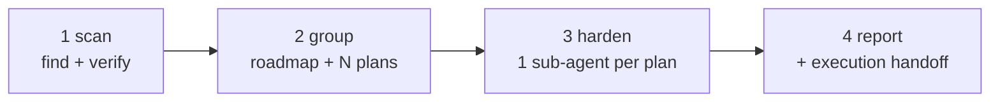

# Create cleanup roadmap

Four phases, in order: **scan → group into roadmap + plans → harden (one sub-agent per plan) →
report**. The deliverable is a directory of plan documents plus a report; the skill never edits
source code.

**Explicit invocation only.** Some agents honour the `disable-model-invocation` frontmatter above;
where that key is ignored, this paragraph is the rule — do not start a scan-and-plan engagement
because a repo looks messy, only because the user asked for one. The run costs a fan-out of
reviewers plus one hardening sub-agent per plan, and it writes a new document tree.

**Parallelism is an optimisation, not a requirement.** Phase 1 fans out inside the scan skill;
phase 3 runs one sub-agent per plan, concurrently when the agent can dispatch and serially when it
cannot (see *No dispatch capability*). Never merge phases: the group phase decides what the plans
say, and the harden phase is an independent read of each finished plan against the code.

## Phase 1 — Scan

Resolve the scope before anything else, and write it down; every later phase quotes it.

1. **Targets.** Default to the repo root; honour paths the user named. Resolve and record:
   languages, frameworks, layering (which package may import which), and the manifest that proves it.
2. **Exclusions.** Always exclude vendor, generated, build output and lockfiles. Then add the
   repo's own noise: generated clients, `*.gen.*`, `*.d.ts`, migrations, data-only files, and test
   fixtures. State the exclusions in the report — a scan whose scope is unstated is not reproducible.
3. **Run the scan.** Invoke the `scan-code-quality` skill with the resolved scope and depth. It owns
   the find phase (one reviewer per quality aspect) and the check phase (an independent verifier per
   finding), including any model-tier flags the user passed.
4. **Keep the ids stable.** The scan's finding ids (category prefix + number) are the contract
   between the roadmap, the plans and the hardening sub-agents. Never renumber them later.
5. **Persist the catalog.** Write the raw findings and the verifier verdicts to files before phase 2.
   Later phases run in fresh sub-agents that cannot see this conversation, so every claim a plan
   makes has to be carried in the plan's own text.
6. **Carry the refutations.** Findings the check phase refuted get no plan; they belong in the
   roadmap's *considered but not flagged* section with the reason.

If the user already has a scan report, skip to phase 2 and use its ids — do not rescan to make the
ids line up.

## Phase 2 — Group into a roadmap and plans

Output directory: `docs/plans/<cleanup-name>/`, where `<cleanup-name>` is a kebab-case topic
(`code-cleanup`, `auth-module-cleanup`, `api-v2-hardening`). `README.md` in that directory is the
roadmap. Use `references/roadmap-template.md` and `references/plan-template.md` as the skeletons.

### Grouping rules

- **Group by kind of change, not by file and not by the scan's categories.** The unit a reviewer
  approves is "delete the dead code", "make the state per-request", "break up the hot path".
- **Delete-only work is its own plan and runs first.** It is zero-risk, needs no decision, and
  shrinks what every later plan has to read.
- **Keep same-file findings in the same plan**, or in strictly ordered plans with the ordering stated
  in both headers. Two plans that rewrite one file must never sit in the same wave.
- **One workstream per plan**, so each plan can be reviewed, merged and reverted on its own.
- **Balance the plans.** Target 5–9 findings and 5–8 tasks per plan. Split a plan that exceeds ~10
  findings, merge one that lands at ≤3 unless it is deliberately the tail (a naming sweep, say).
  Report the sizes in the roadmap table so the balance is visible.
- **Every confirmed finding lands in exactly one plan.** A refuted finding lands in none. A finding
  resolved by another plan's change (a misnamed file that plan 01 deletes) is marked *subsumed*
  against that plan rather than given a task of its own.

### Ordering

Order the plans into waves by real dependency, and say why in the roadmap:

- a module move before the split of the class it moves;
- an injection fix before the extraction that would otherwise touch the same file;
- a small correctness fix in a file before a large rewrite of that file;
- deletion before anything that would have to work around the deleted code.

Draw the waves as a diagram and put the *reason* on each dependency edge, so an implementer who
runs plans out of order sees what breaks.

### What the roadmap contains

Scope and config, summary counts, a **decisions** table, the waves, a plan table
(findings / tasks / depends-on / notes), a finding index (`id`, severity, priority, plan, location,
one-line defect), the refuted list, the definition of done, and the execution handoff.

### What each plan contains

Header (goal, architecture, tech stack, link to the roadmap as its spec), global constraints, then
one task per finding or per extraction step: **Files**, **Interfaces** (what it consumes, what it
produces), **Steps** as tickable one-action checkboxes with the actual commands, and a commit step.
Close with a plan-done checklist. Add a **Behaviour change** line to any task that is not
behaviour-preserving; a task with no such line is claiming it preserves behaviour.

### Rules the plans must obey

- **Evidence required.** Every task cites the file, symbol and metric the finding was confirmed
  against. A task that cites nothing is dropped, not guessed.
- **Non-breaking by default.** Preserve runtime behaviour and wire contracts — procedure names,
  HTTP status codes, persisted keys. Where a change would be client-visible, either keep the old
  behaviour and name the constants around it, or surface it as a decision.
- **Decisions get a default, not a guess.** A product call the code cannot settle (prune rows or
  drop the cron? rethrow the real status or keep the legacy one?) becomes a row in the roadmap's
  decisions table with the conservative default and the flip condition, and the plan implements the
  default.
- **Commands come from the repo.** Read the root manifest, the lint-staged config and the test
  runner config; do not write test commands from memory. Note what the type-check script actually
  covers — in a monorepo it often covers only some workspaces.
- **Names are consistent across plans.** A helper defined in one plan is referenced by the same name
  everywhere else, and a plan that depends on another's symbol says so in its Interfaces block.

### Before hardening: self-check

Run these against your own output and fix inline:

1. every confirmed finding appears in exactly one plan (grep the id across the plan files);
2. no `TBD`, "implement later", "handle edge cases" or other placeholder steps;
3. the roadmap's plan table matches the plan files' contents (finding counts, task counts);
4. shared names are identical everywhere they appear.

## Phase 3 — Harden: exactly one sub-agent per plan

Dispatch **one sub-agent per plan** — never one per finding, never one per wave. One plan keeps a
single owner, and the hardening pass has to see the whole document to judge it. Use the prompt
template in `references/harden-dispatch.md`.

- Each sub-agent invokes the `harden-plan` skill **with the plan's path as its argument** (that skill
  documents a path argument as the way a caller hands it a plan; without it the agent has to guess
  from context, which it cannot, having no conversation).
- Give each sub-agent the roadmap path too: the roadmap is the spec the plan argues from.
- Default to the hardening skill's fix mode. Pass `--no-fix` only when the user asked for a report.
- Sub-agents may edit the plan file they were given, and nothing else. Source code is off limits in
  this pipeline.
- Collect one result per plan: mode run, how many issues it fixed, what it left unresolved, and any
  decision it could not settle. Unresolved product calls go to the user — a hardening sub-agent must
  not invent one, and neither should you.
- If a plan is hardened concurrently with another that rewrites the same file, that is fine: the
  plans are documents. The file conflict belongs in the roadmap's waves, not here.

**No dispatch capability:** harden the plans inline, one at a time — finish a plan, write its result
into the roadmap table, then start the next. Do not interleave two plans; the isolation that a
sub-agent buys is exactly what ordering plus a written result has to replace.

## Phase 4 — Final report

Report, in this order, and stop — this skill produces plans, not code:

1. **Config** — scope, exclusions, depth, plan directory, plan count, hardening mode.
2. **Findings** — confirmed / refuted counts with the severity split.
3. **The plan set** — a table of plan, findings, tasks, hardening outcome.
4. **Coverage** — one line stating every confirmed finding maps to exactly one plan, and where the
   refuted ones were parked.
5. **Decisions** — the rows of the decisions table that need a human, with the default in force.
6. **Execution handoff** — offer the choice: one sub-agent per task with a review between tasks, or
   inline execution in batches with checkpoints. Say which is recommended, and say so explicitly when
   the agent cannot dispatch and inline is the only mode.

## Options

| Option | Effect |
|---|---|
| `--name <cleanup-name>` | Roadmap directory name (default: derive from the user's wording, kebab-case). |
| `--scope <paths>` | Scan targets (default: repo root). |
| `--depth quick\|thorough` | Passed to the scan skill (default `thorough`). |
| `--focus <categories>` | Passed to the scan skill — only those reviewers run. |
| `--no-fix` | Hardening reports instead of fixing. |
| `--no-scan` | Reuse an existing scan report instead of running phase 1. |
| `--plans-only` | Stop after phase 2 — no hardening sub-agents, no report on their outcome. |

## Guardrails

- **Never implement the fixes.** No source edits, no test edits, no dependency changes. If the user
  wants execution, that is the phase-4 handoff.
- **Never drop or merge a confirmed finding to make the plan set balance.** Rebalance by moving
  findings between plans, not by discarding them.
- **Never invent a decision.** A conservative default plus a documented flip condition is the
  answer; silently choosing a breaking option is not.
- **Never let a hardening sub-agent see only a finding id.** It gets the plan path; the plan carries
  the evidence, because sub-agents cannot read this conversation.
- **Never renumber ids** after phase 1 — the roadmap, the plans and the report all cite them.
- **Never claim verification you did not run.** Phase 2's self-check is a read of your own documents;
  say that, rather than describing the plans as tested.

## What this skill does not do

- It does not fix code, run the repo's test suite, or open pull requests.
- It does not design the refactors from scratch: the scan's refactor directions are the input, and
  hardening is what checks them against the code.
- It does not decide priorities for the team — it ranks by the scan's priority score and states the
  dependencies, so the user can re-order the waves.

## References

- `references/roadmap-template.md` — the roadmap (`README.md`) skeleton.
- `references/plan-template.md` — the plan file skeleton, header plus task block.
- `references/harden-dispatch.md` — the one-sub-agent-per-plan prompt template and result format.
