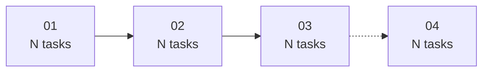

# Roadmap template

The roadmap is `docs/plans/<cleanup-name>/README.md`. It is the spec the plans argue from, so it
travels with them. Fill every placeholder; delete a section only when the run genuinely has nothing
for it, and say why in one line.

```markdown
# <Topic> Cleanup Roadmap

> **For the implementing agent:** This directory holds one roadmap and N plans. Execute one plan at
> a time, one task at a time. Tick each checkbox (`- [ ]` → `- [x]`) as you finish a step, and stop to
> ask if any step is unclear — never guess.

**Goal:** <what the cleanup removes, in one sentence, with the finding count.>

**Architecture:** The work is grouped by kind of change, not by file, so each plan can be reviewed
and merged independently: <numbered list of the workstreams, one line each.>

**Tech Stack:** <language, package manager, frameworks, test runners — copied from the repo's
manifests, not from memory.>

**Spec:** the code-quality scan of this repo (<scope>): <N> candidate findings from the category
reviewers, each independently re-read and scored by a separate verifier. <C> confirmed, <R> refuted.
Every task carries its finding id and the evidence it was confirmed against.

---

## Global Constraints

Every task implicitly includes these. Copy exact values; do not invent variants.

- **Package manager / runner:** <exact commands, from the root manifest.>
- **Lint:** <command>, plus the single-file form.
- **Format:** <command>, and "do not hand-format".
- **Unit tests:** <command>, plus the focused single-file form.
- **Integration / e2e tests:** <command and what they need (a database, a stack) and what to do when
  that is unavailable.>
- **Type-check:** <command and what it actually covers — in a monorepo, name the workspaces it
  skips.>
- **Pre-commit hooks:** <what runs on commit, and the consequence for new code — e.g. a required
  explicit return type.>
- **Commits:** Conventional Commits, one task per commit.
- **No new dependencies.**
- **Non-breaking only**, with the exceptions a plan states under **Behaviour change**.

## Decisions recorded (flip these if the team disagrees)

| # | Decision | Default chosen | Flip condition |
|---|---|---|---|
| D1 | <the product call the code cannot settle> | **<conservative default>**, because <reason> | <what would make the other option right, and where it is implemented> |

## Waves (execution order)



| Plan | Findings | Tasks | Depends on | Notes |
|---|---|---|---|---|
| [01 — <name>](01-<slug>.md) | <n> | <n> | — | <one line: the constraint that matters.> |

## Finding index

`sev`/`prio` are the verifier's adjusted severity and 0–100 priority score from the scan.

| id | sev | prio | plan | location | defect |
|---|---|---|---|---|---|
| <id> | <high\|medium\|low> | <0-100> | <nn> | `<path>::<symbol>` | <one-line defect> |

Refuted in verification, **no work needed**: `<id>` (<why>), `<id>` (<why>).

## Definition of done for every plan

- [ ] Every task's checkboxes are ticked and each task has its own commit.
- [ ] Lint, unit tests and type-check green.
- [ ] No behaviour change beyond what a task's **Behaviour change** line states.
- [ ] The plan's findings are re-checked with the verification given in the task, and the result is
      written into the plan file under the task.

## Execution handoff

Two options once a plan is chosen:

1. **Sub-agent per task (recommended)** — dispatch a fresh sub-agent per task, review its diff, then
   start the next.
2. **Inline execution** — run the tasks in this session in batches, pausing for review between
   batches.

Say which you want before starting plan 01.
```
